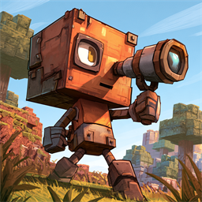
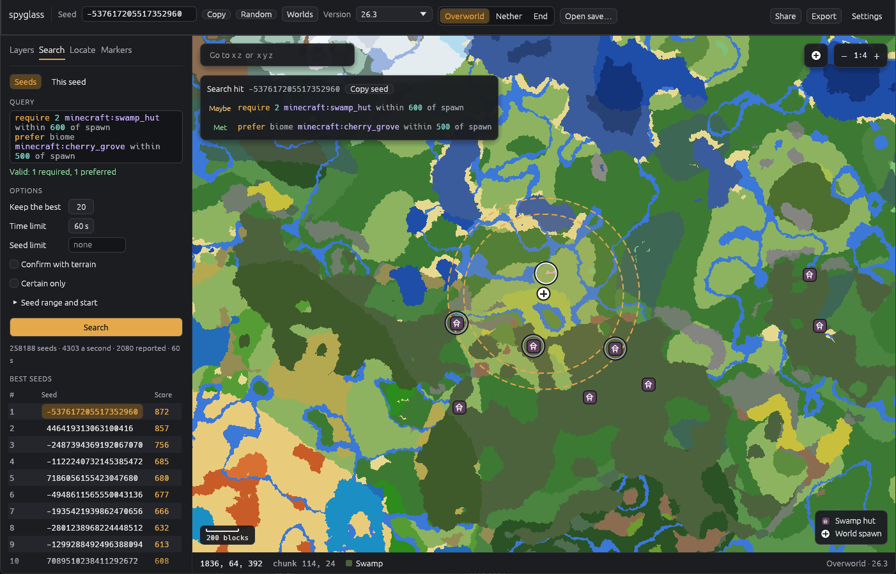

# spyglass



A local-only seed explorer for Minecraft: Java Edition. Describe what you want in a world, and spyglass searches for the seeds that fit best, shows them on a map, and finds where things are in worlds you already play. Output aims to match the game exactly on current versions.

> Status: early. For game versions 26.2, 26.3 and the 26.4 snapshots so far (26.4-snapshot-5 to 26.4-snapshot-8), each checked against the real game, the `spyglass` command answers `/locate`-style questions (structures, biomes, features such as dungeons and geodes, loot containers holding an item, slime chunks, spawn) for any seed or a world save, in the Overworld, the Nether and the End, with `--json` for scripts, gives the blocks the game generates before features, draws maps of them, and searches for the seeds that best fit a query of required and preferred constraints, which can span dimensions ("a fortress near the spawn's portal"), or for the places in one seed that do. The viewer shows the same maps, pannable and zoomable, with layers you choose, a dimension switch and markers of your own, and runs the same searches. Terrain heights decide which structures really generate, so locate answers match the game's `/locate`, with exact bounds for villages, bastions, strongholds and other structures laid out piece by piece; maps can show terrain relief and the biomes at the surface at any scale. New versions are added as they come out, snapshots included, and stay supported ([adding a version](docs/adding-a-version.md)).



More of the viewer is in the [user guide](https://farrcraft.github.io/spyglass/viewer.html).

Not affiliated with or endorsed by Mojang or Microsoft.

## Goals

- **Constraint search.** Give spyglass constraints like "at least 3 witch huts within 500 blocks of spawn, a mushroom fields biome within 2,000, a village and an ancient city nearby", and it searches seeds in parallel and **ranks** the best matches. Constraints are required (a seed must meet them) or preferred (a seed scores higher the better it meets them).
- **Visual preview.** Open any seed on a pannable, zoomable map, and choose what to render: biomes, chosen structure types, slime chunks, spawn, or highlights of specific biomes.
- **Your existing worlds.** Point spyglass at a local world save and it reads the seed, version and world settings, then answers "where is the nearest stronghold, ancient city or mushroom island from here?" for that world, not just for theoretical seeds.
- **All three dimensions:** Overworld, Nether and End.
- **Library first.** Everything is a Rust library. A command-line tool (JSON output, for scripts) and the GUI are both thin front ends over the same API, so anything the GUI can show, a script can compute.
- **Local only.** No server, no account, no telemetry. The only network access is downloading the game's own server jar from Mojang, which the extractor (or the viewer, when asked to) does once per version.

## Why

Existing seed tools either hand-port per-version tables and fall behind new releases, or are closed-source web apps. spyglass keeps the **algorithms** in Rust and **extracts per-version parameters automatically** from the game's own jar. Supporting a new version should mean running the extractor, diffing the output and fixing the code that actually changed, not re-porting tables by hand. Correctness is checked against the real game, not assumed.

Mojang's data and code are never committed or redistributed. The extractor runs locally against a server jar you download yourself.

## Install

Download the archive for your system from the [releases page](https://github.com/farrcraft/spyglass/releases/latest): Windows, Linux, or macOS (Apple silicon or Intel). Unpack it into a folder of its own and start `spyglass-viewer`. With no game data yet, it extracts some for you, into a `bundles` folder beside it; that needs a Java runtime matching the game version. No Rust is needed. The [user guide](https://farrcraft.github.io/spyglass/) covers the rest: the warnings unsigned programs get on Windows and macOS, game data, the viewer and the `spyglass` command.

## Build from source

```sh
# Windows (PowerShell)
./scripts/setup.ps1

# macOS / Linux
./scripts/setup.sh
```

Then:

```sh
cargo xtask doctor   # is this machine ready?
cargo build
cargo test
```

With a version bundle extracted, ask a seed where things are, as the game's `/locate` would. Extracting needs a Java runtime matching the game version (Java 25 for 26.3); if you've played that version, the launcher's runtime is found automatically ([Java](docs/getting-started.md#java)):

```sh
cargo run -p spyglass-extract -- 26.3
cargo run --release -p spyglass-cli -- locate structure '#minecraft:village' --seed 12345
cargo run --release -p spyglass-cli -- locate structure '#minecraft:village' --world "My World" --from player
cargo run --release -p spyglass-cli -- locate structure minecraft:fortress --seed 12345 --dimension nether
cargo run --release -p spyglass-cli -- locate feature minecraft:monster_room --seed 12345
cargo run --release -p spyglass-cli -- loot find minecraft:enchanted_golden_apple --seed 12345 --radius 16
cargo run --release -p spyglass-cli -- render --seed 12345 --structures '#minecraft:village' --spawn -o map.png
cargo run --release -p spyglass-cli -- search -q 'require 2 minecraft:swamp_hut within 600 of spawn' --time 60s
cargo run --release -p spyglass-cli -- search -q 'require minecraft:fortress within 150 of spawn' --time 60s
cargo run --release -p spyglass-viewer
```

See [docs/getting-started.md](docs/getting-started.md) for the full walkthrough, including installing Rust by hand, and the [user guide](https://farrcraft.github.io/spyglass/) for [the `spyglass` command](https://farrcraft.github.io/spyglass/command.html) and [the viewer](https://farrcraft.github.io/spyglass/viewer.html).

## Crates

| Crate                | Role                                                                       |
| -------------------- | -------------------------------------------------------------------------- |
| `spyglass-rng`       | Bit-exact ports of the game's RNGs.                                        |
| `spyglass-noise`     | Bit-exact ports of the game's noise.                                       |
| `spyglass-data`      | Reads version bundles; shared JSON and NBT readers.                        |
| `spyglass-extract`   | Builds version bundles from your own server jar.                           |
| `spyglass-oracle`    | Test support: reads the oracle's golden files.                             |
| `spyglass-density`   | Loads and evaluates density-function graphs.                               |
| `spyglass-biome`     | Climate sampling and biome lookup.                                         |
| `spyglass-terrain`   | Terrain heights and block columns, with aquifers.                          |
| `spyglass-blocks`    | A chunk's blocks before features: surface, ore veins and carvers.          |
| `spyglass-structure` | Placement, validity checks and jigsaw assembly.                            |
| `spyglass-feature`   | Decoration: features such as dungeons and geodes, as the game places them. |
| `spyglass-loot`      | A container's contents from its loot table and seed.                       |
| `spyglass-search`    | The search query language and parallel runner.                             |
| `spyglass-world`     | Reads your world saves.                                                    |
| `spyglass`           | The public API that every front end uses.                                  |
| `spyglass-cli`       | The `spyglass` command, with `--json` for scripts.                         |
| `spyglass-viewer`    | Native map app: layers, locate, search, markers, saves, export.            |

See [docs/architecture.md](docs/architecture.md) for how they fit together.

## Documentation

- [User guide](https://farrcraft.github.io/spyglass/) ([source](docs/guide/src/SUMMARY.md))
- [Getting started](docs/getting-started.md), for working on spyglass
- [Architecture](docs/architecture.md)
- [Specs](docs/specs/)
- [Adding a game version](docs/adding-a-version.md)
- [Roadmap](docs/roadmap/README.md)
- [Implementation plans](docs/plans/README.md)
- [Development process](docs/development-process.md)
- [Changelog](CHANGELOG.md) and [releasing](docs/releasing.md)
- [Contributing](CONTRIBUTING.md) and [security](SECURITY.md)
- [Decision records](docs/adr/)
- [Research](docs/research/)

## License

[MIT](LICENSE). This covers spyglass's own code only. Minecraft's code and data stay under Mojang's terms, which is why spyglass never ships them.
