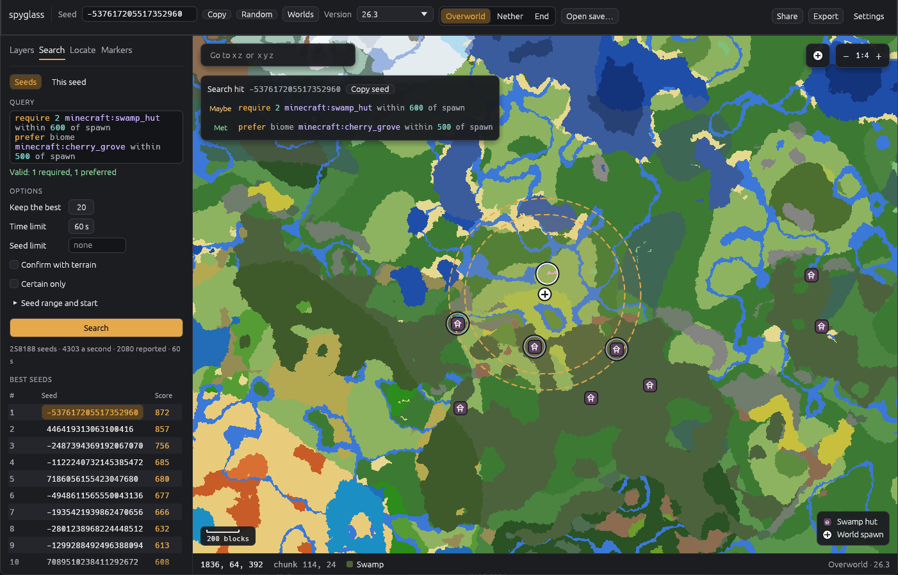

# spyglass

spyglass explores Minecraft: Java Edition seeds on your own computer. It finds where structures, biomes, features and loot are, draws maps of all three dimensions, and searches for the seeds that fit what you want. It works for seeds and for your own world saves, and its answers match the game's exactly.

It runs entirely on your machine: no account, no server and no telemetry. The only download it makes is the game's own server jar, from Mojang, once for each game version. spyglass ships nothing of Mojang's.

## Where to start

1. [Install spyglass](install.md): download the archive for your system.
2. [Get the game data](game-data.md) for the game versions you play. The viewer does this for you on its first run.
3. Explore with [the viewer](viewer.md), or ask [the `spyglass` command](command.md) from a terminal.

Not affiliated with or endorsed by Mojang or Microsoft.
