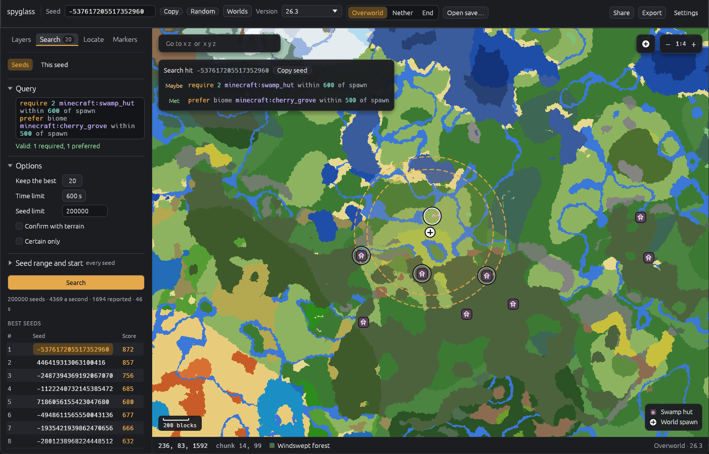

# spyglass

spyglass explores Minecraft: Java Edition seeds on your own computer. It can:

- find structures, biomes, dungeons, geodes and loot chests;
- draw maps of the Overworld, the Nether and the End;
- search for the seeds that fit what you want, such as two witch huts near spawn;
- show which flower bone meal grows where, and where Nether portals link.

It works for any seed, and for your own world saves. Its answers match the game's exactly.

It runs entirely on your computer: no account, no server and no tracking. It only goes online to download the game's own files from Mojang, once for each game version. spyglass ships nothing of Mojang's.

## Where to start

1. [Install spyglass](install.md): download the archive for your system.
2. [Get the game data](game-data.md) for the game versions you play. The viewer does this for you the first time you start it.
3. Explore in [the viewer](viewer.md), a map app, or ask questions from a terminal with [the `spyglass` command](command.md).

Not affiliated with or endorsed by Mojang or Microsoft.
