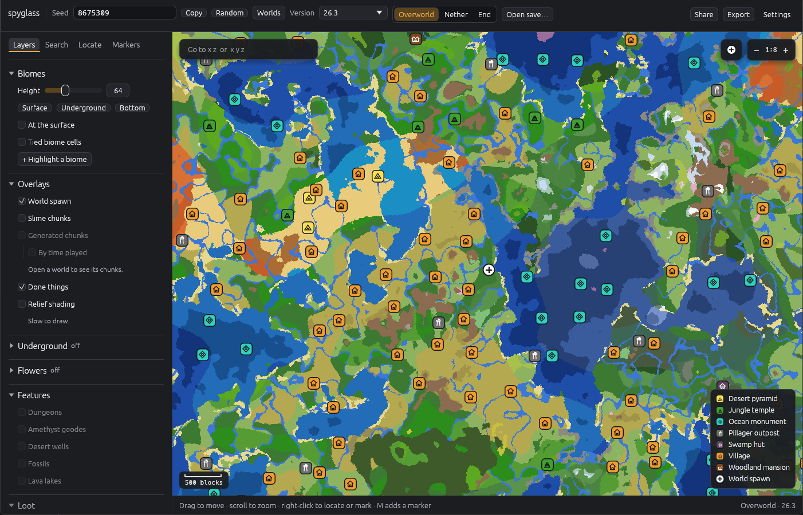
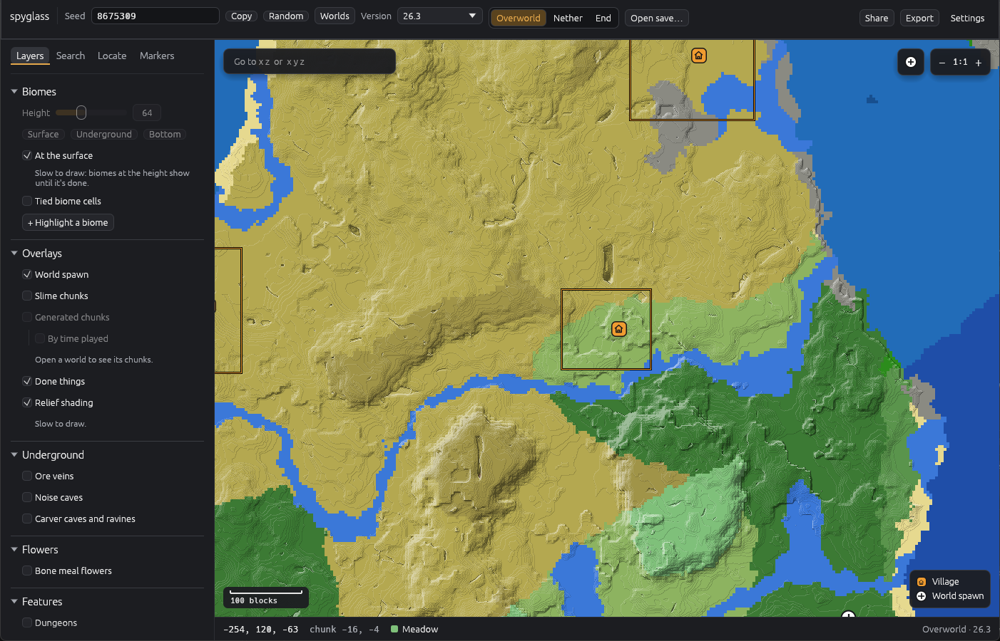
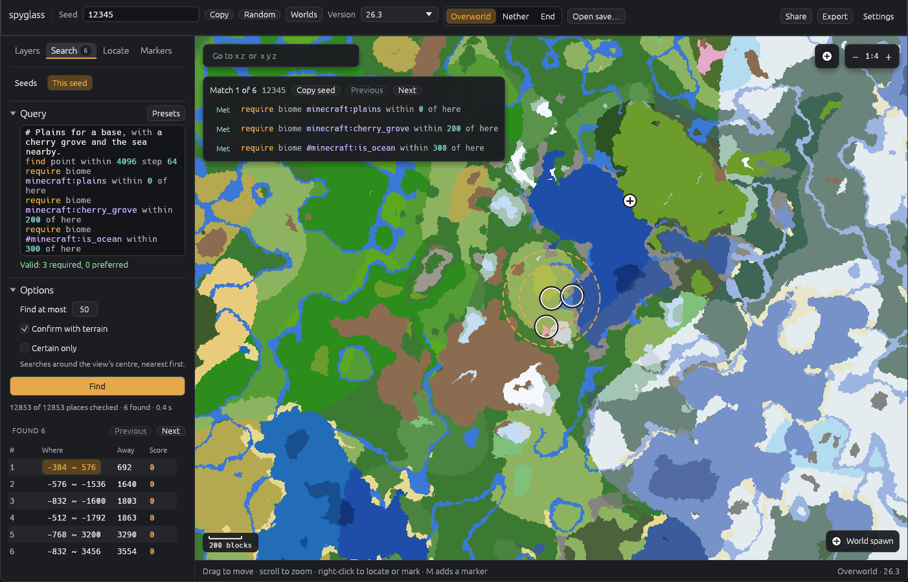
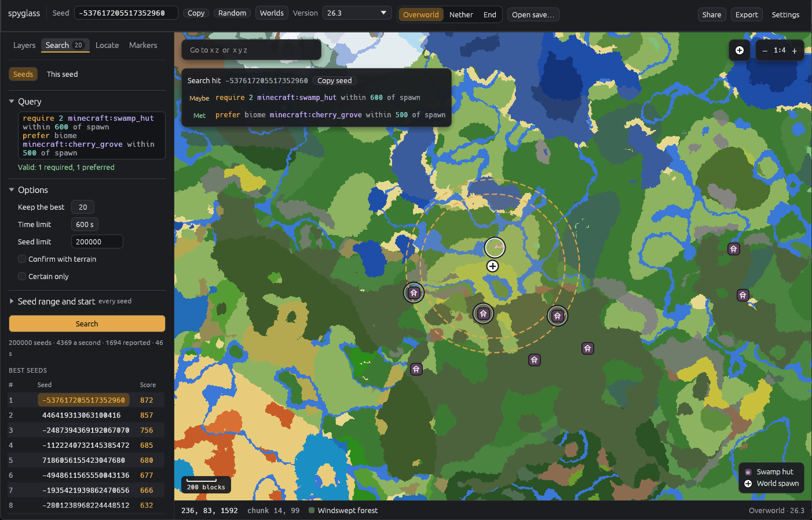

# The viewer

Start `spyglass-viewer`. It opens the newest release in the bundles folder (or the newest snapshot, if there's no release) and shows seed 0. With no bundles yet, it offers to [extract some](game-data.md#from-the-viewer). Settings are kept between runs.

## Moving around

Drag to pan, and scroll to zoom around the pointer, or use the arrow keys and `+` and `-`. **Go to** takes `x z` or `x y z`. The status bar shows the block, chunk, biome and terrain height under the pointer.

## The side panel

The side panel has five tabs: **Layers**, **Search**, **Locate**, **Markers**, and **World** while a save is shown. A tab's count shows beside its name: the places or seeds the last search found, locate's hits, your markers in this dimension, and the save's warnings in amber. A spinner shows there while a search or a locate runs.

Each tab is in sections. Click a section's title or its arrow to fold it away; folded, it says in a word what's in it, such as **2 on**, **on, paused** or **3 warnings**, so a fold never hides a warning. Folds are kept between runs. **What spyglass read** above the map opens the World tab with the sections that hold a warning unfolded.

## Seeds, saves and dimensions

- **Seed or save:** type a seed and press Enter, or open a save from the launchers' list or any folder. A save opens on its player, in the player's dimension, with its [data packs](data-packs.md) applied and named above the map, with how many warnings spyglass has about it.
- **World tab:** while a save is shown, the side panel's **World** tab has [what spyglass read from it](your-worlds.md#what-spyglass-read): its settings and where each came from, its data packs and what they change, and what each dimension holds, each warning under what it's about. **Go** beside the spawn, the player or a dimension moves the map there. **This map so far** counts what the map has taken from the save: chunks read, structures answered from the save, and containers found unopened, opened or gone. **What spyglass read** above the map opens the tab. A save spyglass can't show, such as one whose data packs it can't apply yet, still has its World tab, opened from the button beside the error, so you can see why.
- **Dimension:** switch between the Overworld, the Nether and the End. Each keeps its own view. Slime chunks and the spawn are the Overworld's, and terrain layers aren't drawn in the Nether, whose surface is its ceiling.
- **Game version:** **Version** in the toolbar picks one of the bundles you have, and **Add a game version** in **Settings** extracts another.

## Layers

- **Biomes**, at the height **Height** sets, with **Surface**, **Underground** (y 0) and **Bottom** presets. Biomes you choose to highlight stay bright and the rest are dimmed.
- **At the surface**, under Biomes, and **Relief shading**, under Overlays: each column's biome at its own height, and the map shaded by terrain height. Each pixel needs its column's height, so both fill in slowly, and more slowly the further out you zoom: a screen takes a few seconds at 4 blocks per pixel and up to a minute or so from 32 out. The quicker biomes at **Height** show while they're worked out.
- **Structures** to mark. Hover a marker for what it is.
- **Tied biome cells**, **slime chunks** and **the world spawn**.
- **Generated chunks**, with one of your worlds open, at 16 blocks per pixel or closer: the chunks it has generated, magenta, fainter where generated partway, amber where an older version generated them; **By time played** shades them instead by how long players spent nearby. Structures and loot in those chunks come from your world ([your own worlds](your-worlds.md#what-the-world-already-holds)): a structure there is listed as **Saved**, and a container's window says whether it's been opened and what it holds now.
- **Flowers**: what bone meal grows on grass at each block, at the height shown, with a key of the flowers in view. Click a flower in the key to show only it, and **Best height** lists the heights where it covers most of the view ([flower farms](flower-farms.md#in-the-viewer)).
- **Confirm with terrain** (on by default) decides structure markers and locates with the seed's terrain, as the game does, and up close draws the bounds of villages, other jigsaw structures and mineshafts.

### Zoom limits

Some layers are drawn only when you zoom in, since they cost more to draw:

| Layer                                                  | Drawn at                      |
| ------------------------------------------------------ | ----------------------------- |
| Ore veins, noise caves, carver caves                   | 4 blocks per pixel or closer  |
| Features (dungeons, geodes, wells, …)                  | 2 blocks per pixel or closer  |
| Loot containers, and rings round those holding an item | 2 blocks per pixel or closer  |
| Slime chunks, a world's generated chunks               | 16 blocks per pixel or closer |
| The bounds of villages and other jigsaw structures     | 4 blocks per pixel or closer  |

- **Underground**: ore veins (copper orange, iron blue, filler stone fainter), noise caves (darkened), and the caves and ravines carvers cut (yellow and magenta), at the height shown. Moving the height keeps the carvers already worked out.
- **Features**: dungeons, amethyst geodes, desert wells, fossils and lava lakes, as diamonds, filled when certain and outlined when likely. Each chunk is placed as the game decorates it, so they fill in slowly.

Past its limit a layer's checkbox is greyed, says **paused**, and its hover text says how far to zoom in. It stays on, and draws again when you zoom back in; zooming out also stops the work it was doing, so the rest of the view fills in sooner. Features and loot containers go one step further: at 4 blocks per pixel the map still shows those found closer in, with nothing new worked out. The area looked at is outlined and the rest is hatched, so an empty outlined patch means there's none there, and a hatched one that it wasn't looked at.

Dungeons found at 2 blocks per pixel, still shown at 4 with their layer paused: the area looked at is outlined, and the rest hatched.

Zooming in or out reuses what's been worked out: zoom in from 2 blocks per pixel to 1 with features on and they're all there at once, and zoom out over tiles already drawn and they're copied, not worked out again.

Up close, with **Relief** and **Biomes at the surface** on, and the bounds of a plains village drawn:

The Nether, with fortresses and bastions marked:

## Locating

Right-click the map for the nearest structure, feature or biome from there, as `/locate` would. Hits are listed in the side panel (click one to go there) and pinned on the map. Where the nearest structure isn't `/locate`'s answer, both are listed and pinned, the nearest first ([why](answers.md#search-order-and-the-nearest)).

## Loot

The **Loot** section of the Layers tab shows what's in the chests, at 2 blocks per pixel or closer:

- **Containers** marks every chest, barrel and other loot container that structures and dungeons place.
- **Ring those holding** takes an item, such as `minecraft:diamond`, and rings the containers holding it in gold: a full ring where one certainly does, a thin ring where it might.

Click a container for its contents, slot by slot, as the seed generates them, and whether they're certain. With an item chosen, right-clicking the map offers **Nearest** that item. Each chunk is placed as the game decorates it, so containers fill in slowly.

Seed 12345 in 26.3 at 1 block per pixel, centred on 0, 200, with every container marked and those holding a diamond ringed. A mineshaft's chest minecart at -158 44 372 is open:

## Markers and done places

- **Markers:** right-click the map and **Add a marker here**, or press M over it, then name it and pick a colour. Click a marker to edit it. The **Markers** tab lists the world's markers in the dimension shown, and what you've marked done.
- **Done:** right-click a structure, a locate pin or a search match and **Mark done**. Done things are drawn dimmed. Untick **Done things** in the Layers tab to hide them. A structure stays done when you switch game versions.
- **Portal markers:** right-click the map and **Add a portal here** for a Nether portal, its lowest block at the view's height. In its window, set its height, direction and size. In the other dimension, the blocks it aims at, the square the game searches around them, and a line to the portal it lands at (or _new portal_) are drawn. Right-click a portal and **Show its link area** to shade where a new portal on the other side would link to it. See [Nether portals](portals.md).
- **Worlds:** every seed and save you open is kept as a recent world, with its markers and where you left it. Name one in the Markers tab to keep it, and open any from **Worlds** in the toolbar.

Markers, done places and worlds are kept in `spyglass-data.json`, beside the settings:

| System  | Folder                                    |
| ------- | ----------------------------------------- |
| Windows | `%APPDATA%\spyglass\data\`                |
| macOS   | `~/Library/Application Support/spyglass/` |
| Linux   | `~/.local/share/spyglass/`                |

Seed 12345 in 26.3 at 4 blocks per pixel, with villages, outposts and witch huts marked, two markers added, and the village at -144, -832 marked done:

**Settings** shows where, and exports all of it, or one world, to a file that **Import…** merges into another spyglass's. The format is [documented](https://github.com/farrcraft/spyglass/blob/main/docs/specs/user-data.md), so scripts can read it too.

## Sharing and exporting

- **Share → Copy the view text** copies a line such as `spyglass:1;s=12345;v=26.3;d=overworld;c=0,0;sc=4;y=64;l=spawn,confirm`. Paste it into **Share → Open a view text**, or onto the map, to open the same seed, version, dimension, view and layers. Your markers aren't in it.
- **Export → Image of this view…** saves the view as a PNG, with your markers in view as pins unless you untick **Include markers**. **Export → Copy the command that draws it** copies the [`spyglass render`](maps.md) command that draws the same image.

## Searching

The **Search** tab has two modes:

- **Seeds** finds the seeds that best fit a query, written in the [search language](seed-search.md). Set a seed count or a time limit (and **Confirm with terrain** to decide structures), and press **Search**. The best seeds appear as they're found. Click one to open it, in its first constraint's dimension and centred on that constraint's place, with everything its constraints matched ringed.
- **This seed** finds [places in the seed shown](search-in-seed.md), around the view's centre. Pick a query from **Presets** (double witch huts, a monument in deep ocean, a pillager outpost on flat ground, mushroom fields, ice spikes, a pale garden, a cherry grove by the sea) or write one, and press **Find**. The nearest match opens on the map. **Previous** and **Next**, or P and N on the map, step through the rest.

Seed 12345 in 26.3 at 4 blocks per pixel, after **Find** with the **Cherry grove by the sea** preset and **Confirm with terrain** on:

A search for seeds, with the best opened:

Rendering runs in the background on all but one core, so the map stays responsive while tiles fill in.
