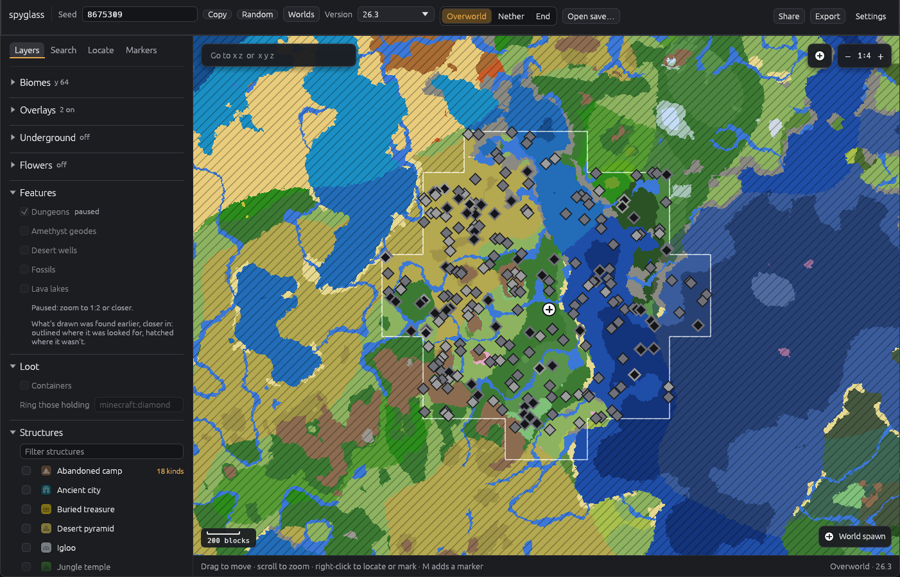
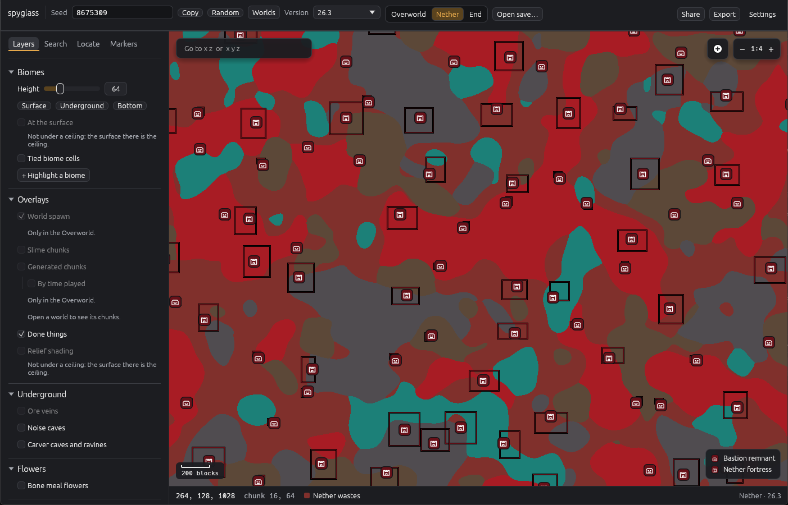
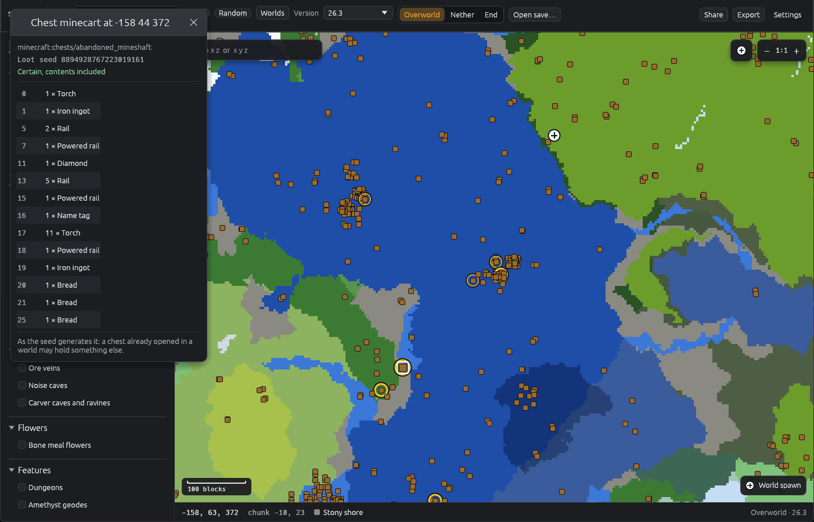
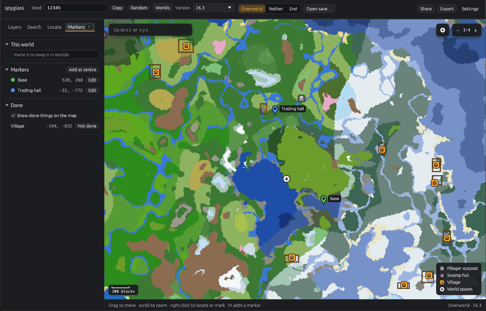

# The viewer

Start `spyglass-viewer`. The first time, it shows seed 0 in the newest game version you have. After that, it opens where you left off. If you have no game data yet, it offers to [extract some](game-data.md#from-the-viewer).

The window has three parts:

- **The toolbar**, along the top: the seed, the game version, the dimension, opening a save, and the **Share**, **Export** and **Settings** menus.
- **The side panel**, on the left: what to draw, searches, locate results and your markers.
- **The map**, with the status bar under it.

## Moving around

- **Pan:** drag the map, or use the arrow keys.
- **Zoom:** scroll over the map, or press `+` and `-`. The zoom control at the top right shows the scale: **1:4** means one pixel is 4 blocks across. **1:1** is closest.
- **Go to a place:** press G, or click **Go to** at the top left of the map, then type `x z` or `x y z` and press Enter. With `x y z`, the y also sets the height the map is drawn at.
- **Back to spawn:** the button beside the zoom control centers the map on the world spawn.

The status bar shows the block, chunk, biome and terrain height under the pointer. While the map is still being drawn, it shows how many tiles are left.

Right-click the map for a menu: locate from there, center the map there, copy the coordinates, add a marker or a portal, or copy the view text.

## Seeds, saves and versions

- **A seed:** type it in **Seed** in the toolbar and press Enter. **Copy** copies it, and **Random** picks a new one.
- **A save:** **Open save…** lists the saves in the Minecraft Launcher and the Modrinth App, or opens any save folder. The map opens on your player, in the player's dimension, with the world's [data packs](data-packs.md) applied. spyglass never changes your save.
- **Dimension:** **Overworld**, **Nether** and **End** in the toolbar. Each keeps its own view. Slime chunks and the world spawn are only in the Overworld. Terrain layers aren't drawn in the Nether, since its "surface" is the roof.
- **Game version:** **Version** in the toolbar picks one of the versions you have. To get another, open **Settings** and choose **Add a game version**.

## The side panel

The side panel has a tab for each job: **Layers**, **Search**, **Locate** and **Markers**, plus **World** while a save is open. A small count beside a tab's name shows what it holds: the search's results, locate's results, your markers in this dimension, or the save's warnings (in amber). A spinner shows there while a search or locate is running.

Each tab is divided into sections. Click a section's title to fold it away. A folded section still sums up what's in it, such as **2 on**, **on, paused** or **3 warnings**, so folding never hides a warning. The viewer remembers which sections you folded.

## Layers

The **Layers** tab chooses what the map draws.

- **Biomes:** the biomes at the height **Height** sets. **Surface**, **Underground** (y 0) and **Bottom** set it quickly. **At the surface** draws each column's biome at its own ground level instead. **Tied biome cells** marks the rare places where two biomes fit exactly as well, so the game's choice can't be predicted. **+ Highlight a biome** keeps the biomes you pick bright and dims the rest.
- **Overlays:** **World spawn**, **Slime chunks**, **Done things** (see [markers](#markers-and-done-places)) and **Relief shading**, which shades the map by terrain height. With a save open, **Generated chunks** shows the chunks your world has already generated: magenta, fainter where only partly generated, and amber where an older game version generated them. **By time played** shades them by how long players spent nearby instead.
- **Underground:** **Ore veins** (copper orange, iron blue), **Noise caves** (darkened), and **Carver caves and ravines** (caves yellow, ravines magenta), all at the height the map is drawn at.
- **Flowers:** **Bone meal flowers** shows which flower bone meal grows on grass at each block. See [flower farms](flower-farms.md#in-the-viewer).
- **Features:** **Dungeons**, **Amethyst geodes**, **Desert wells**, **Fossils** and **Lava lakes**, as diamonds: filled when certain, outlined when only likely.
- **Loot:** chests and other containers. See [loot](#loot).
- **Structures:** the structures to mark. Type in **Filter structures** to find one, and hover a marker on the map to see what it is.
- **Confirm with terrain** (on unless you turn it off) checks the ground at each structure, as the game does, so the markers show only structures that really generate. Up close, it also draws the outlines of villages, other structures built from pieces, and mineshafts.

**At the surface** and **Relief shading** need every column's terrain height, so they're slow, and slower the further out you zoom: a screen takes a few seconds at 1:4, and up to a minute or so from 1:32 out. The quicker biomes at **Height** show until they're ready.

### Zoom limits

Some layers take a lot of work, so they're drawn only when you zoom in close enough:

| Layer                                                       | Drawn at       |
| ----------------------------------------------------------- | -------------- |
| Features (dungeons, geodes, wells, …)                       | 1:2 or closer  |
| Loot containers                                             | 1:2 or closer  |
| Ore veins, noise caves, carver caves                        | 1:4 or closer  |
| Outlines of villages and other structures built from pieces | 1:4 or closer  |
| Slime chunks, a world's generated chunks                    | 1:16 or closer |

When you zoom out past a layer's limit, its checkbox turns gray and says **paused**. Hover it to see how far to zoom in. The layer stays on, and draws again when you zoom back in.

Features and loot containers you've already found stay visible one step further out, at 1:4. The area that was searched is outlined, and the rest of the map is hatched. So an empty outlined patch has none, and a hatched patch just hasn't been looked at.

Seed 8675309 in 26.3 at 1:4, after finding dungeons at 1:2:

Zooming reuses work already done. Zoom in from 1:2 to 1:1 and the features are all there at once. Zoom out over tiles already drawn and they're reused, not worked out again.

Seed 8675309 in 26.3 at 1:1, centered on a plains village at -320, -320, with **At the surface** and **Relief shading** on and the village's outline drawn:

Seed 8675309 in 26.3, the Nether at 1:4 centered on 0, 0, with fortresses and bastions marked:

## Locating

Right-click the map and choose **Nearest structure**, **Nearest feature** or **Nearest biome** to find the nearest one from that spot, as the game's `/locate` command would. The results are pinned on the map and listed in the **Locate** tab. Click one to go there.

The game's `/locate` doesn't always give the nearest structure. When it doesn't, the **Locate** tab lists both: **/locate gives** with the game's answer, and **Nearest** with the nearest one ([why](answers.md#search-order-and-the-nearest)). **Clear** removes the pins.

## Loot

The **Loot** section of the **Layers** tab shows what's in chests, at 1:2 or closer:

- **Containers** marks every chest, barrel and other container that structures and dungeons generate with loot.
- **Ring those holding** takes an item, such as `minecraft:diamond`, and rings the containers holding it in gold: a full ring where one certainly does, a thin ring where it might.

Click a container to see its contents slot by slot, as the seed generates them. With an item chosen, the right-click menu can also find the nearest container holding it. Containers fill in slowly, since spyglass generates each chunk's contents as the game does.

Seed 12345 in 26.3 at 1:1, centered on 0, 200, with every container marked and those holding a diamond ringed. A mineshaft's chest minecart at -158 44 372 is open:

## Markers and done places

- **Markers:** right-click the map and choose **Add a marker here**, or press M with the pointer over the map. Give it a name and a color. Click a marker to edit it. The **Markers** tab lists the markers in the dimension you're viewing, and **Add at centre** adds one in the middle of the view.
- **Done:** right-click a structure, a locate pin or a search result and choose **Mark done**, for places you've visited or looted. Done things are drawn dimmed. To hide them, untick **Done things** in the Layers tab. A structure stays done when you switch game versions.
- **Portals:** right-click the map and choose **Add a portal here** to mark a Nether portal, with its lowest block at the map's height. In its window, set its height, direction and size. In the other dimension, the viewer then draws where the portal leads and which portal it lands at, or _new portal_ if it would build one. Right-click a portal and choose **Show its link area** to see where a portal on the other side would link to it. See [Nether portals](portals.md).
- **Worlds:** every seed and save you open is remembered, with its markers and where you left the map. Name one in the **Markers** tab to keep it, and open any of them from **Worlds** in the toolbar. **Forget this world** removes one.

The viewer keeps markers, done places and worlds in `spyglass-data.json`, next to its settings:

| System  | Folder                                    |
| ------- | ----------------------------------------- |
| Windows | `%APPDATA%\spyglass\data\`                |
| macOS   | `~/Library/Application Support/spyglass/` |
| Linux   | `~/.local/share/spyglass/`                |

**Settings** shows the file's location. **Export all…** and **Export this world…** save them to a file, and **Import…** adds a file exported from another copy of spyglass. The format is [documented](https://github.com/farrcraft/spyglass/blob/main/docs/specs/user-data.md), so scripts can read it too.

Seed 12345 in 26.3 at 1:4, centered on 200, -250, with villages, pillager outposts and swamp huts marked, two markers added (Base at 528, 268 and Trading hall at -32, -772), and the village at -144, -832 marked done:

## Your worlds

When a save is open, the **World** tab shows [what spyglass read from it](your-worlds.md#what-spyglass-read): its settings and where each came from, its data packs and what they change, and what each dimension holds. Each warning is listed under the thing it's about. **Go** beside the spawn, the player or a dimension moves the map there.

**This map so far** counts what the map has taken from the save: chunks read, structures found in the save, and containers that are unopened, opened or gone.

Above the map, a line names the save and its data packs, and says how many warnings spyglass has about it. **What spyglass read** there opens the **World** tab, with the sections that have warnings unfolded. If spyglass can't show a save at all, for example because it can't apply one of its data packs yet, the **World** tab still opens from the button beside the error, so you can see why.

## Sharing and exporting

- **Share → Copy the view text** copies a line such as `spyglass:1;s=12345;v=26.3;d=overworld;c=0,0;sc=4;y=64;l=spawn,confirm`. Paste it into **Share → Open a view text**, or onto the map, to open the same view. It holds the seed, version, dimension, position, scale and height, the structures, features and flower shown, the highlighted biomes, and which of the map layers are on. It doesn't hold your markers, generated chunks, loot or done things.
- **Export → Image of this view…** saves the view as a PNG. Your markers in view are drawn as pins, unless you untick **Include markers**.
- **Export → Copy the command that draws it** copies the [`spyglass render`](maps.md) command that draws the same image.

## Searching

The **Search** tab has two modes.

### Seeds

**Seeds** finds the seeds that best fit a query, written in the [search language](seed-search.md):

1. Type the query.
2. Set when to stop: **Time limit**, **Seed limit**, or both. **Keep the best** says how many seeds to keep.
3. Optionally, turn on **Confirm with terrain** to check each structure's ground (off by default here, since it's slower), or **Certain only**. **Seed range and start** limits the search to some seeds.
4. Press **Search**. The best seeds are listed as they're found. **Stop** ends the search early.

Click a seed to open it. The map opens in its first constraint's dimension, centered on that constraint's place, with everything the query matched ringed. A card on the map shows each constraint as **Met**, **Maybe** (met if the uncertain candidates generate) or **No**, and **Copy seed** copies the seed.

Seed -5376172055517352960 in 26.3, the best of 200,000 seeds (**Seed limit** 200000, **Confirm with terrain** off) for the query shown: two swamp huts within 600 blocks of spawn, and a cherry grove within 500 preferred:

### This seed

**This seed** finds [places in the seed you're viewing](search-in-seed.md), starting from the middle of the view. Pick a query from **Presets**, or write your own, and press **Find**. The presets are double witch huts, a monument in deep ocean, a pillager outpost on flat ground, mushroom fields, ice spikes, a pale garden, and a cherry grove by the sea.

The nearest match opens on the map. **Previous** and **Next**, or P and N on the map, step through the rest.

Seed 12345 in 26.3 at 1:4, after **Find** from 0, 0 with the **Cherry grove by the sea** preset and **Confirm with terrain** on:

The map is drawn in the background on all but one of your processor's cores, so the viewer stays responsive while tiles fill in.
