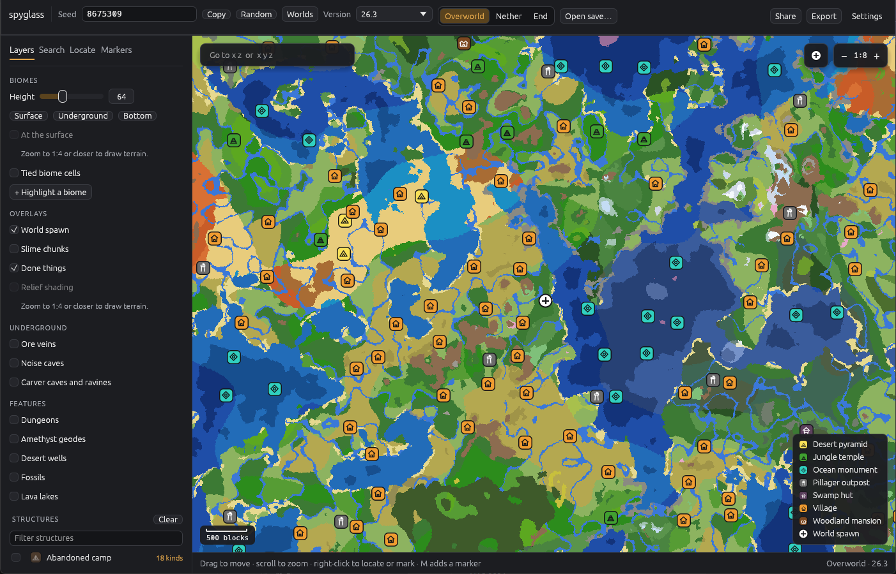
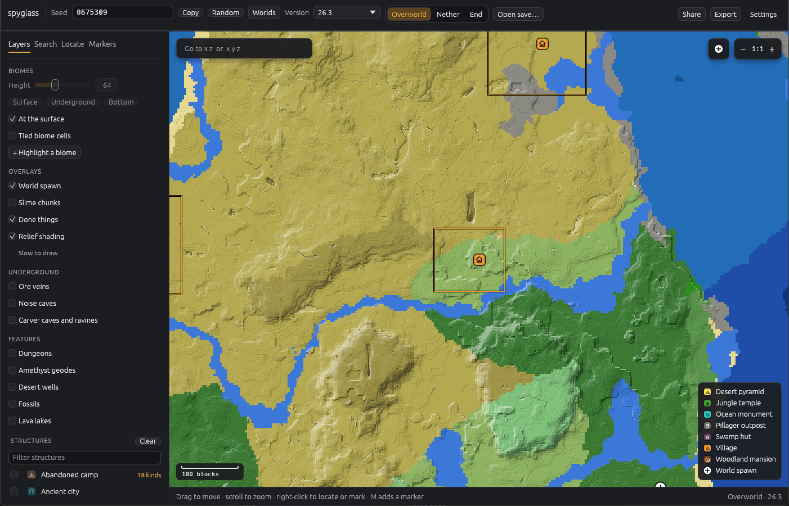
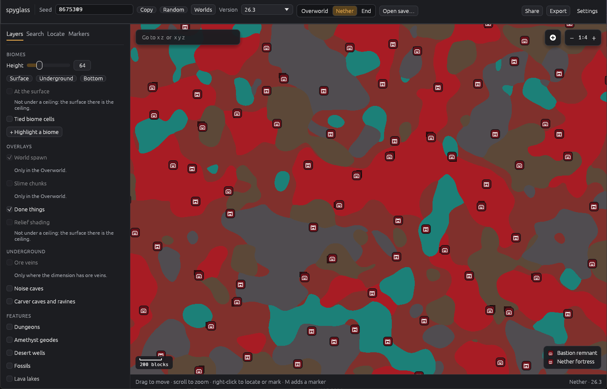
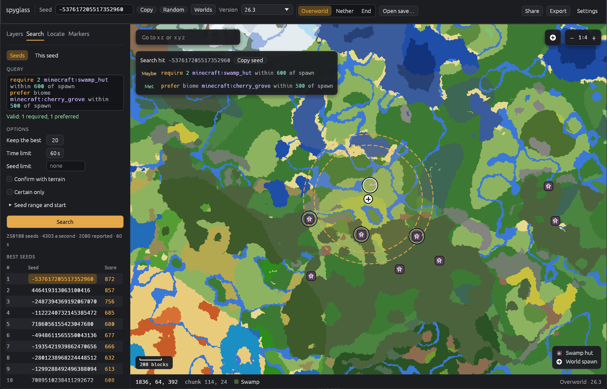

# The viewer

Start `spyglass-viewer`. It opens the newest release in the bundles folder (or the newest snapshot, if there's no release) and shows seed 0. With no bundles yet, it offers to [extract some](game-data.md#from-the-viewer). Settings are kept between runs.

## Moving around

Drag to pan, and scroll to zoom around the pointer, or use the arrow keys and `+` and `-`. **Go to** takes `x z` or `x y z`. The status bar shows the block, chunk, biome and terrain height under the pointer.

## Seeds, saves and dimensions

- **Seed or save:** type a seed and press **Show**, or open a save from the launchers' list or any folder. A save opens on its player, in the player's dimension, with anything that makes its answers inexact listed (see [your own worlds](your-worlds.md)).
- **Dimension:** switch between the Overworld, the Nether and the End. Each keeps its own view. Slime chunks and the spawn are the Overworld's, and terrain layers aren't drawn in the Nether, whose surface is its ceiling.
- **Game version:** the World section picks the version from the bundles you have, and **Add a game version** extracts another.

## Layers

- **Biomes**, at the height **Height** sets, with **Surface**, **Underground** (y 0) and **Bottom** presets. Biomes you choose to highlight stay bright and the rest are dimmed.
- **Structures** to mark. Hover a marker for what it is.
- **Tied biome cells**, **slime chunks** and **the world spawn**.
- **Confirm with terrain** (on by default) decides structure markers and locates with the seed's terrain, as the game does, and up close draws the bounds of villages, other jigsaw structures and mineshafts.

Some layers appear only when you zoom in, since they cost more to draw:

- **Relief** and **Biomes at the surface**, at 4 blocks per pixel or closer: the map shaded by terrain height, and each column's biome at its own height. Both fill in slowly.
- **Underground**, at 4 blocks per pixel or closer: ore veins (copper orange, iron blue, filler stone fainter), noise caves (darkened), and the caves and ravines carvers cut (yellow and magenta), at the height shown. Moving the height keeps the carvers already worked out.
- **Features**, at 2 blocks per pixel or closer: dungeons, amethyst geodes, desert wells, fossils and lava lakes, as diamonds, filled when certain and outlined when likely. Each chunk is placed as the game decorates it, so they fill in slowly.

Up close, with **Relief** and **Biomes at the surface** on, and the bounds of a plains village drawn:

The Nether, with fortresses and bastions marked:

## Locating

Right-click the map for the nearest structure, feature or biome from there, as `/locate` would. Hits are listed in the side panel (click one to go there) and pinned on the map. Where the nearest structure isn't `/locate`'s answer, both are listed and pinned, the nearest first ([why](answers.md#search-order-and-the-nearest)).

## Loot

The **Loot** section of the Layers tab shows what's in the chests, at 2 blocks per pixel or closer:

- **Containers** marks every chest, barrel and other loot container that structures and dungeons place.
- **Ring those holding** takes an item, such as `minecraft:diamond`, and rings the containers holding it in gold: a full ring where one certainly does, a thin ring where it might.

Click a container for its contents, slot by slot, as the seed generates them, and whether they're certain. With an item chosen, right-clicking the map offers **Nearest** that item. Each chunk is placed as the game decorates it, so containers fill in slowly.

## Markers and done places

- **Markers:** right-click the map and **Add a marker here**, or press M over it, then name it and pick a colour. Click a marker to edit it. The **Markers** tab lists the world's markers in the dimension shown, and what you've marked done.
- **Done:** right-click a structure, a locate pin or a search match and **Mark done**. Done things are drawn dimmed. Untick **Done things** in the Layers tab to hide them. A structure stays done when you switch game versions.
- **Worlds:** every seed and save you open is kept as a recent world, with its markers and where you left it. Name one in the Markers tab to keep it, and open any from **Worlds** in the toolbar.

Markers, done places and worlds are kept in `spyglass-data.json`, beside the settings:

| System  | Folder                                    |
| ------- | ----------------------------------------- |
| Windows | `%APPDATA%\spyglass\data\`                |
| macOS   | `~/Library/Application Support/spyglass/` |
| Linux   | `~/.local/share/spyglass/`                |

**Settings** shows where, and exports all of it, or one world, to a file that **Import…** merges into another spyglass's. The format is [documented](https://github.com/farrcraft/spyglass/blob/main/docs/specs/user-data.md), so scripts can read it too.

## Sharing and exporting

- **Share → Copy the view text** copies a line such as `spyglass:1;s=12345;v=26.3;d=overworld;c=0,0;sc=4;y=64;l=spawn,confirm`. Paste it into **Share → Open a view text**, or onto the map, to open the same seed, version, dimension, view and layers. Your markers aren't in it.
- **Export image…** saves the view as a PNG, with your markers in view as pins unless you untick **Include markers**. **Copy command** copies the [`spyglass render`](maps.md) command that draws the same image.

## Searching

The **Search** tab has two modes:

- **Seeds** finds the seeds that best fit a query, written in the [search language](seed-search.md). Set a seed count or a time limit (and **Confirm with terrain** to decide structures), and press **Search**. The best seeds appear as they're found. Click one to open it, in its first constraint's dimension and centred on that constraint's place, with everything its constraints matched ringed.
- **This seed** finds [places in the seed shown](search-in-seed.md), around the view's centre. Pick a query from **Presets** (double witch huts, a monument in deep ocean, a flat outpost, rare biomes, a base site) or write one, and press **Find**. The nearest match opens on the map. **Previous** and **Next**, or P and N on the map, step through the rest.

Rendering runs in the background on all but one core, so the map stays responsive while tiles fill in.
